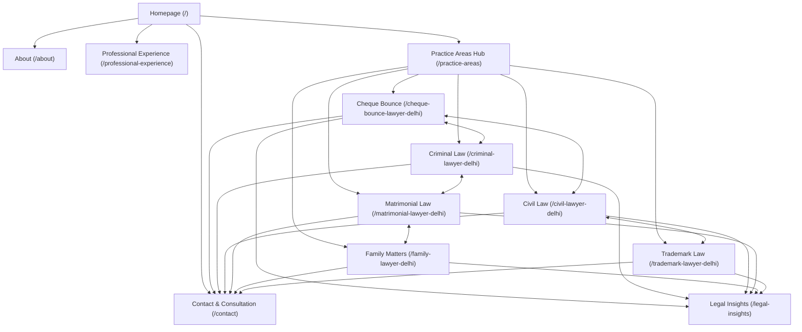

# TECHNICAL & EDITORIAL SEO STRATEGY & COMPLIANCE GUIDE
**Chamber of Advocate Shubham Singh | New Delhi, India**

---

## 1. Executive Summary & Regulatory Framework
This website is established as a strictly informational resource for Advocate Shubham Singh, practicing primarily before the Supreme Court of India, the High Court of Delhi, District & Sessions Courts, and statutory commissions across Delhi NCR.

### Bar Council of India (BCI) Rule 36 Strict Compliance
Under Rule 36, Section IV, Chapter II, Part VI of the Bar Council of India Rules:
- **No Solicitation or Canvassing**: An advocate shall not solicit work or advertise, either directly or indirectly, whether by circulars, advertisements, touts, personal communications, or interviews not warranted by personal relations.
- **Informational Restraint**: Information published online must be limited to factual particulars: name, designation, enrolled bar council, contact coordinates (once verified), educational qualifications (once verified), courts of practice, and verified areas of practice.
- **Strict Prohibition on Superlatives & Testimonials**:
  - NEVER use terms such as *"Best Lawyer"*, *"Top Advocate"*, *"Leading Counsel"*, *"No. 1"*, or *"Famous Lawyer"*.
  - NEVER post client testimonials, reviews, ratings, star endorsements, or case outcome claims.
  - NEVER promise or guarantee legal results, bail grants, or trial outcomes.
  - NEVER advertise fees, discounts, free consultations, or promotional pricing.

Every SEO initiative, meta tag, publication, and schema object on this site complies strictly with these statutory duties.

---

## 2. Search Console Verification & Sitemap Submission

### Step 1: Verification Options
1. **Domain-Level DNS Verification (Recommended)**:
   - Sign in to [Google Search Console](https://search.google.com/search-console).
   - Add property: `shubhamsinghadvocate.com` (Domain property).
   - Copy the `TXT` verification token (e.g. `google-site-verification=...`).
   - Add the TXT record in the DNS management console of the domain registrar (Cloudflare / Namecheap / GoDaddy).
   - Click **Verify**. Domain-level verification automatically validates `https://`, `http://`, `www.`, and non-www variants.
2. **Alternative HTML Tag Verification**:
   - If DNS access is restricted, copy the meta tag from GSC and insert the token into `src/lib/metadata.ts` under `verification.google`.

### Step 2: Sitemap Submission
- Navigate to **Index -> Sitemaps** in Google Search Console.
- Submit the live sitemap URL:
  ```
  https://shubhamsinghadvocate.com/sitemap.xml
  ```
- Verify status returns **Success** with all 13 primary indexable URLs discovered.

### Step 3: Priority Indexing Requests
Submit initial URL inspection and manual index requests in the following sequence:
1. `https://shubhamsinghadvocate.com/` (Homepage)
2. `https://shubhamsinghadvocate.com/cheque-bounce-lawyer-delhi` (Section 138 NI Act)
3. `https://shubhamsinghadvocate.com/criminal-lawyer-delhi` (Bail, Trial & Appeals)
4. `https://shubhamsinghadvocate.com/civil-lawyer-delhi` (Commercial & Property Suits)
5. `https://shubhamsinghadvocate.com/matrimonial-lawyer-delhi` (Family Court Proceedings)
6. `https://shubhamsinghadvocate.com/trademark-lawyer-delhi` (Delhi High Court IPD)
7. `https://shubhamsinghadvocate.com/family-lawyer-delhi` (Guardianship & Succession)
8. `https://shubhamsinghadvocate.com/professional-experience` (Institutional Empanelments)
9. `https://shubhamsinghadvocate.com/about` (Chamber Standing)
10. `https://shubhamsinghadvocate.com/contact` (Consultation Intake)

---

## 3. Bing Webmaster Tools & IndexNow Integration

### Step 1: Account Setup & Verification
- Sign in to [Bing Webmaster Tools](https://www.bing.com/webmasters).
- Authenticate via Google Search Console import for 1-click verified ownership transfer.
- Submit `https://shubhamsinghadvocate.com/sitemap.xml`.

### Step 2: IndexNow Real-Time Indexing
- Generate a 32-character IndexNow API key.
- Host the key at `/public/{key}.txt`.
- When new articles or practice updates are deployed, submit the URLs via the IndexNow REST endpoint:
  ```bash
  POST https://api.indexnow.org/IndexNow
  Content-Type: application/json
  {
    "host": "shubhamsinghadvocate.com",
    "key": "your-indexnow-key",
    "urlList": [
      "https://shubhamsinghadvocate.com/cheque-bounce-lawyer-delhi"
    ]
  }
  ```

---

## 4. Consent-Aware Analytics (DPDP Act 2023 Compliant)

### Legal Mandate: Digital Personal Data Protection Act, 2023
Section 6 and Section 8 of the Indian DPDP Act, 2023 mandate verifiable consent and purpose limitation when processing personal identifiers (including IP addresses, cookie device identifiers, and behavioral trackers).

### Recommendation: Privacy-First Cookieless Analytics
To maintain pristine editorial dignity and eliminate intrusive cookie banners:
1. **Deploy Cookieless Analytics (Plausible or Self-Hosted Umami)**:
   - Does not place HTTP cookies on the visitor's device.
   - Does not store personal identifiable information (PII) or IP addresses.
   - 100% compliant with DPDP Act 2023, GDPR, and PECR without needing consent banners.
   - Script payload $< 1.5\text{ KB}$, preserving 100/100 Core Web Vitals.
2. **If Google Analytics 4 (GA4) is deployed by client preference**:
   - Must implement Google Consent Mode v2 (`analytics_storage: 'denied'`).
   - Must disable Google Signals, User-ID tracking, and Ad Personalization.
   - Strict intake form anonymization: Never track form input text (names, case descriptions, phone numbers) in analytics custom event parameters.

---

## 5. Google Business Profile (GBP) — Separate Workstream

> [!IMPORTANT]
> **Strict Prerequisite**: Do not create or verify a Google Business Profile until Advocate Shubham Singh's physical chamber address in Delhi is verified and confirmed. Google will suspend listings that use co-working spaces, virtual addresses, or residential locations without physical client-reception capability.

### Setup Checklist (Post-Address Verification)
1. **Primary Category**: `Lawyer` or `Legal Services` or `Trial Attorney`.
2. **Secondary Categories**:
   - `Criminal Justice Attorney`
   - `Civil Law Attorney`
   - `Family Law Attorney`
   - `Patent & Trademark Attorney`
3. **Business Name**: `Advocate Shubham Singh` (Strictly do NOT add keyword-stuffed modifiers like *"Best Criminal Lawyer Delhi"*; Google algorithmically flags and suspends such titles).
4. **Physical Location**: Enter verified Delhi chamber address matching bar council directory records.
5. **Verification Protocol**:
   - Google generally requires an official video verification walkthrough showing:
     - Street name and building exterior.
     - Chamber nameplate outside the office door (`Advocate Shubham Singh`).
     - Interior working space, advocate library, and bar council certificates.
6. **BCI Rule 36 Policy on Reviews**:
   - Google Business Profile automatically enables reviews.
   - **Compliance Rule**: The chamber must NEVER actively solicit reviews, offer inducements, or embed Google Reviews on the website. Informational presence only.

---

## 6. Keyword and Search Intent Table for the Six Services

| Practice Area | Primary Keyword | Search Intent | Secondary / Long-Tail Query Variations | Delhi NCR Specificity | Target URL | BCI Compliant Framing |
| :--- | :--- | :--- | :--- | :--- | :--- | :--- |
| **Cheque Bounce Matters** | Cheque bounce lawyer in Delhi | Procedural / Remedial | Section 138 NI act notice timeline, cheque bounce court procedure Delhi, cheque dishonour complaint limitation period | Designated NI Act Courts, Saket, Patiala House, Tis Hazari, Karkardooma, Rohini, Dwarka | `/cheque-bounce-lawyer-delhi` | Factual explanation of 30-day notice and 15-day settlement window under Section 138 |
| **Criminal Law** | Criminal defence lawyer in Delhi | Remedial / Urgent Procedural | Anticipatory bail advocate Delhi, regular bail Delhi High Court, Section 482 petition quashing FIR, BNSS bail provisions | Supreme Court of India, Delhi High Court, Special CBI/ED Courts, District Sessions | `/criminal-lawyer-delhi` | Constitutional safeguards, bail jurisprudence, and trial defence procedure |
| **Civil Litigation** | Civil litigation lawyer in Delhi | Procedural / Commercial | Property dispute advocate Delhi, commercial suit mandatory mediation, injunction application under Order 39 CPC, execution petition | Delhi High Court Original Side, Commercial Courts Act, District Courts | `/civil-lawyer-delhi` | Analysis of CPC timelines, commercial suits, and mandatory pre-institution mediation |
| **Matrimonial Law** | Matrimonial lawyer in Delhi | Procedural / Mediation | Mutual consent divorce procedure Delhi, Section 13B HMA cooling period waiver, maintenance petition Section 125, Family Court mediation | Family Courts at Dwarka, Rohini, Saket, Tis Hazari, Rouse Avenue | `/matrimonial-lawyer-delhi` | Dignified mediation options, statutory grounds under personal laws, mutual consent steps |
| **Family Matters** | Family law advocate in Delhi | Informational / Remedial | Partition suit procedure Delhi, succession certificate District Court, guardianship petition Hindu Minority and Guardianship Act | District Courts, Guardianship Courts Delhi NCR | `/family-lawyer-delhi` | Statutory framework for inheritance, intestate succession, and child custody welfare |
| **Trademark Law** | Trademark lawyer in Delhi | Commercial / Statutory | Trademark opposition hearing Delhi, trademark infringement interim injunction, Intellectual Property Division Delhi High Court | Intellectual Property Division (IPD) Delhi High Court, Trade Marks Registry Dwarka | `/trademark-lawyer-delhi` | Protection of brand identity, opposition stages, and interim relief under Trade Marks Act 1999 |

---

## 7. 10-Article Editorial Content Plan

> [!NOTE]
> Every article in this plan is structured as an authoritative procedural briefing. In accordance with chamber practice rules, each article must undergo factual verification and legal review by Advocate Shubham Singh prior to publication.

### Article 1: Section 138 NI Act — Mandatory Timelines & Cause of Action
- **Target Keywords**: *Section 138 notice timeline*, *cheque bounce 30 days limitation Delhi*.
- **Intent**: Procedural guidance for payees and drawers.
- **Core Topics**:
  - Receipt of bank return memo with official reason for dishonour.
  - Strict 30-day window to dispatch statutory demand notice.
  - The 15-day payee response period; accrual of cause of action on Day 16.
  - Section 142(1)(b) condonation of delay principles in designated MM courts.
- **Target URL**: `/legal-insights/section-138-ni-act-timelines`
- **Review Status**: Pending Advocate Legal Review.

### Article 2: Bail Jurisprudence Under the New Criminal Sanhitas (CrPC vs BNSS)
- **Target Keywords**: *Bail under BNSS 2023*, *Bharatiya Nagarik Suraksha Sanhita anticipatory bail Delhi*.
- **Intent**: Statutory comparison for litigants and advocates.
- **Core Topics**:
  - Section 480 & 482 of BNSS corresponding to Sections 437, 438, 439 CrPC.
  - Judicial discretion in regular vs anticipatory bail before Sessions and High Court.
  - Police custody timelines and modern electronic summons provisions.
- **Target URL**: `/legal-insights/bail-jurisprudence-bnss-crpc`
- **Review Status**: Pending Advocate Legal Review.

### Article 3: Interim Injunctions in Intellectual Property: Practice Before Delhi High Court IPD
- **Target Keywords**: *Delhi High Court IPD trademark injunction*, *Order 39 Rule 1 2 CPC trademark Delhi*.
- **Intent**: Commercial IP litigation overview.
- **Core Topics**:
  - Evolution of the Intellectual Property Division (IPD) at the High Court of Delhi.
  - The tripartite test: prima facie case, balance of convenience, and irreparable injury.
  - Ex-parte ad-interim injunctions and appointment of Local Commissioners under Order 26 CPC.
- **Target URL**: `/legal-insights/delhi-high-court-ipd-trademark-injunctions`
- **Review Status**: Pending Advocate Legal Review.

### Article 4: Pre-Institution Mediation Under the Commercial Courts Act, 2015
- **Target Keywords**: *Section 12A commercial courts act Delhi*, *mandatory mediation commercial suit*.
- **Intent**: Procedural compliance for corporate litigants.
- **Core Topics**:
  - Mandatory nature of Section 12A pre-institution mediation (*Patil Automation* Supreme Court ruling).
  - Exception: urgent interim relief under Commercial Courts Act.
  - Role of Delhi State Legal Services Authority (DSLSA) in conducting commercial mediation.
- **Target URL**: `/legal-insights/commercial-courts-mandatory-mediation-section-12a`
- **Review Status**: Pending Advocate Legal Review.

### Article 5: Mutual Consent Divorce Under Section 13B: Six-Month Waiver Conditions
- **Target Keywords**: *Section 13B mutual consent divorce Delhi*, *cooling off period waiver Supreme Court*.
- **Intent**: Family court procedural clarification.
- **Core Topics**:
  - First Motion and Second Motion statutory structure under Hindu Marriage Act, 1955.
  - Supreme Court precedent (*Amardeep Singh v. Harveen Kaur*) on waiving the 6-month statutory waiting period.
  - Court considerations regarding permanent alimony, child custody, and return of Stridhan.
- **Target URL**: `/legal-insights/mutual-consent-divorce-cooling-off-waiver`
- **Review Status**: Pending Advocate Legal Review.

### Article 6: Property Partition Suits in Delhi: Preliminary vs Final Decree
- **Target Keywords**: *Partition suit procedure Delhi district courts*, *preliminary decree partition India*.
- **Intent**: Civil property dispute litigation steps.
- **Core Topics**:
  - Determining shares in coparcenary and ancestral property.
  - Difference between preliminary decree (declaring rights) and final decree (metes and bounds division).
  - Appointment of court-appointed local commissioners for site measurement and demarcation.
- **Target URL**: `/legal-insights/property-partition-suit-procedure-delhi`
- **Review Status**: Pending Advocate Legal Review.

### Article 7: Quashing of Criminal Proceedings Under Section 482 CrPC / Section 528 BNSS
- **Target Keywords**: *Quashing FIR Delhi High Court*, *Section 482 petition grounds*.
- **Intent**: Appellate and inherent powers commentary.
- **Core Topics**:
  - Scope of High Court's inherent power to prevent abuse of process of any court.
  - Settlement-based quashing in matrimonial or commercial offences (*Gian Singh* and *State of Haryana v. Bhajan Lal* principles).
  - High Court thresholds when prima facie cognizable offence is disclosed.
- **Target URL**: `/legal-insights/quashing-criminal-proceedings-inherent-powers`
- **Review Status**: Pending Advocate Legal Review.

### Article 8: Trademark Opposition Proceedings Before the Trade Marks Registry
- **Target Keywords**: *Trademark opposition procedure India*, *Form TM-O filing timeline*.
- **Intent**: Statutory IP registration procedure.
- **Core Topics**:
  - 4-month advertisement window in the Trade Marks Journal.
  - Grounds of opposition under Section 9 (absolute) and Section 11 (relative grounds).
  - Counter-statement timelines (Rule 44), evidence in support of opposition, and hearing stage.
- **Target URL**: `/legal-insights/trademark-opposition-procedure-timeline`
- **Review Status**: Pending Advocate Legal Review.

### Article 9: Child Custody & Guardianship: Welfare of the Minor as Paramount Consideration
- **Target Keywords**: *Child custody lawyer Delhi*, *guardianship petition family court*.
- **Intent**: Matrimonial and family law procedure.
- **Core Topics**:
  - Legal framework under the Guardians and Wards Act, 1890 and Hindu Minority and Guardianship Act, 1956.
  - The "Welfare of the Child" doctrine as prioritized over parental rights.
  - Interim visitation rights, shared parenting plans, and international custody protocols.
- **Target URL**: `/legal-insights/child-custody-guardianship-welfare-doctrine`
- **Review Status**: Pending Advocate Legal Review.

### Article 10: Summary Suits Under Order 37 CPC for Debt & Commercial Recovery
- **Target Keywords**: *Order 37 CPC summary suit Delhi*, *leave to defend procedure*.
- **Intent**: Civil commercial recovery overview.
- **Core Topics**:
  - Eligible instruments: bills of exchange, hundis, promissory notes, and written contracts.
  - Strict 10-day defendant appearance timeline following service of summons.
  - Summons for judgment and tests for granting unconditional or conditional "Leave to Defend".
- **Target URL**: `/legal-insights/order-37-cpc-summary-suits-debt-recovery`
- **Review Status**: Pending Advocate Legal Review.

---

## 8. Internal-Linking Architecture Plan



### Architectural Principles:
1. **Hub-and-Spoke Topology**:
   - The Practice Areas Directory (`/practice-areas`) acts as the primary category hub.
   - Each individual practice page functions as an authoritative spoke.
   - The Related Practice Jurisdictions module links related spokes horizontally (e.g. Cheque Bounce links to Criminal Law and Civil Litigation).
2. **Contextual Action Links**:
   - Every service page features direct, descriptive anchor links connecting:
     - Practice Area $\to$ Chamber Intake (`/contact`) with explicit intent (*"Initiate Consultation on Cheque Bounce Matters"*).
     - Practice Area $\to$ Editorial Insights (`/legal-insights`) with educational intent (*"Read Procedural Notes"*).
3. **Breadcrumbs Microdata**:
   - Every inner route renders a hairline semantic breadcrumb trail transmitting `BreadcrumbList` JSON-LD to search engines.
   - Zero `#` links across all components.

---

## 9. Monthly SEO & Technical Health Routine

### Week 1: Crawl & Indexing Audit
- [ ] Check Google Search Console **Coverage / Page Indexing** tab for crawl anomalies (404s, 500s, blocked by robots.txt).
- [ ] Verify that `sitemap.xml` has been processed recently without parse errors.
- [ ] Ensure non-indexable thin routes (such as empty publication states) remain strictly tagged with `noindex, nofollow`.

### Week 2: Core Web Vitals & Performance Monitoring
- [ ] Run Lighthouse tests on mobile and desktop viewports across:
  - Homepage (`/`)
  - At least one Service landing page (`/cheque-bounce-lawyer-delhi`)
  - Intake page (`/contact`)
- [ ] Verify metrics meet Google's Good threshold:
  - **Largest Contentful Paint (LCP)**: $\le 2.0\text{ s}$
  - **Interaction to Next Paint (INP)**: $\le 200\text{ ms}$
  - **Cumulative Layout Shift (CLS)**: $0.00$
- [ ] Verify image compression: Hero AVIF/WebP formats serving correctly.

### Week 3: Security & Header Verification
- [ ] Inspect HTTP response headers using curl or securityheaders.com:
  - `Strict-Transport-Security`: `max-age=63072000; includeSubDomains; preload`
  - `X-Content-Type-Options`: `nosniff`
  - `Referrer-Policy`: `strict-origin-when-cross-origin`
  - `X-Frame-Options`: `DENY`
  - `Content-Security-Policy`: `frame-ancestors 'none'`
- [ ] Test form CSRF, rate-limiting, and timing protections under `/api/contact`.

### Week 4: Bar Council Compliance Review
- [ ] Conduct a full-site textual scan for inadvertent superlative adjectives (*"best"*, *"expert"*, *"leading"*, *"guaranteed"*).
- [ ] Confirm no user testimonials or reviews have been added to the site.
- [ ] Confirm verified-only profile fields rule: phone, address, and credentials remain omitted until verified by the client.
- [ ] Verify DPDP Act 2023 disclaimer and BCI Rule 36 notices remain clearly visible in footer and disclaimers.

---

*Chamber of Advocate Shubham Singh &bull; New Delhi, India &bull; Strictly Informational Resource*
